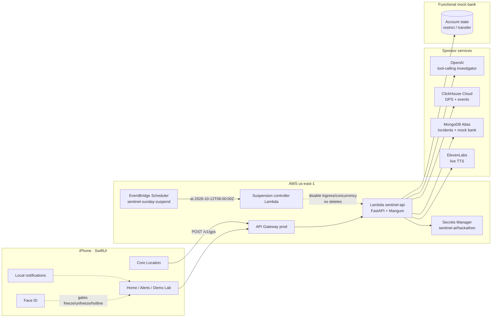
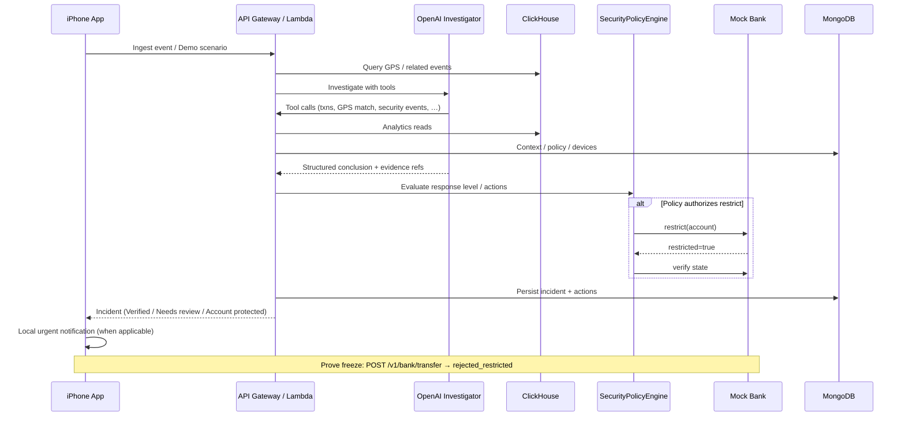
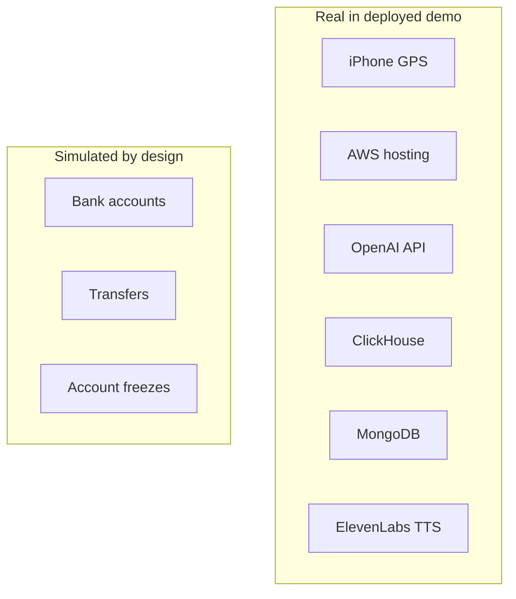

# Sentinel AI architecture

This document reflects the **deployed** hackathon MVP (AWS `us-east-1`, API Gateway → Lambda FastAPI), not an aspirational redesign.

## System diagram

## Autonomous execution flow

## Trust boundaries

| Boundary | Rule in this MVP |
|----------|------------------|
| **LLM → bank** | OpenAI may *recommend* protection. It cannot call mock-bank restrict APIs directly. |
| **Policy → bank** | `SecurityPolicyEngine` (deterministic) must authorize restrict/unrestrict. |
| **Device → API** | Bearer token + `X-Sentinel-User`. Hackathon auth, not Cognito. |
| **User → freeze UI** | Face ID / biometrics required for freeze, unfreeze, keep-frozen, and hotline TTS. |
| **Public incident API** | Consumer fields only; raw `tool_trace` is stripped from client responses. |
| **Suspension controller** | Can disable project ingress/compute; **cannot** delete stacks, DBs, GPS, or secrets. Independent of `sentinel-api` concurrency. |

## Component map (as deployed)

| Component | Implementation |
|-----------|----------------|
| Mobile | `ios/SentinelAI` SwiftUI |
| API | `backend/app` on Lambda `sentinel-api` |
| Agent | `backend/app/agents` + `integrations/openai_client.py` |
| Mock bank | `backend/app/simulation/mock_bank.py` |
| Scenarios | `backend/app/simulation/scenarios.py` |
| Infra | `infrastructure/cdk` (`SentinelAI-Api`, `SentinelAI-Suspension`) |

## Live vs simulated (architecture view)

## Related docs

- Residual suspend costs: [`aws-suspension-and-costs.md`](aws-suspension-and-costs.md)
- Security notes: [`security.md`](security.md)
- Submission package: [`../submission/FINAL_SUBMISSION.md`](../submission/FINAL_SUBMISSION.md)
